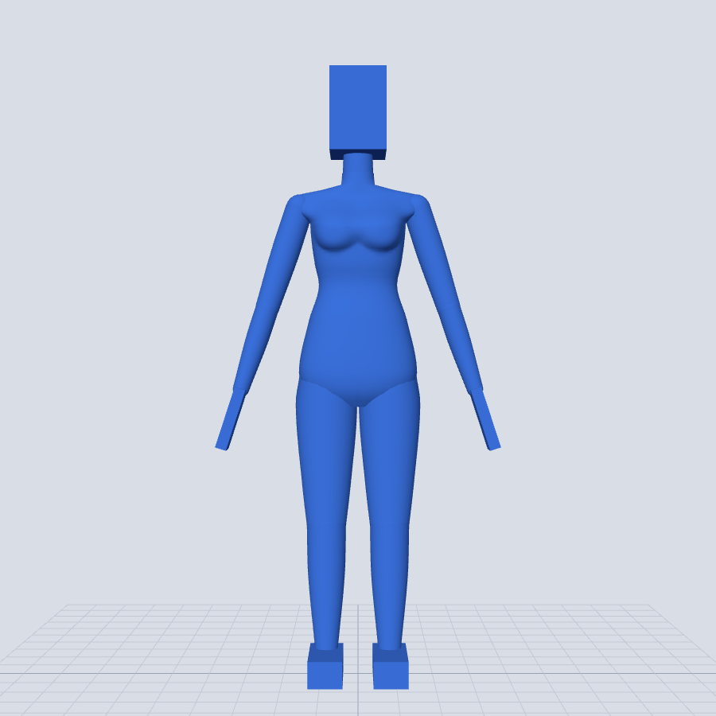
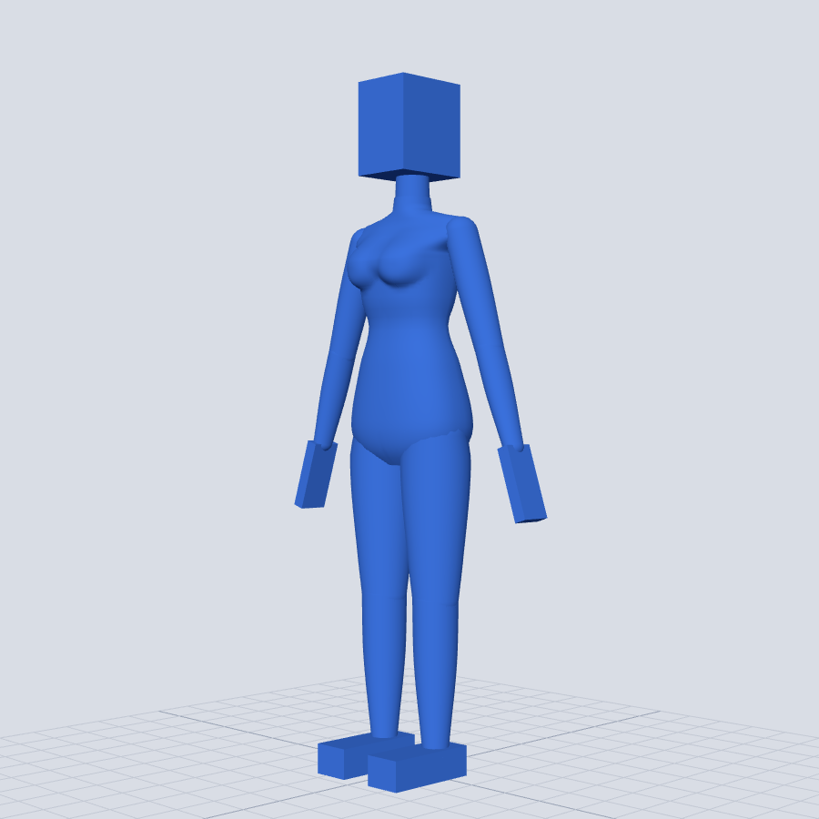
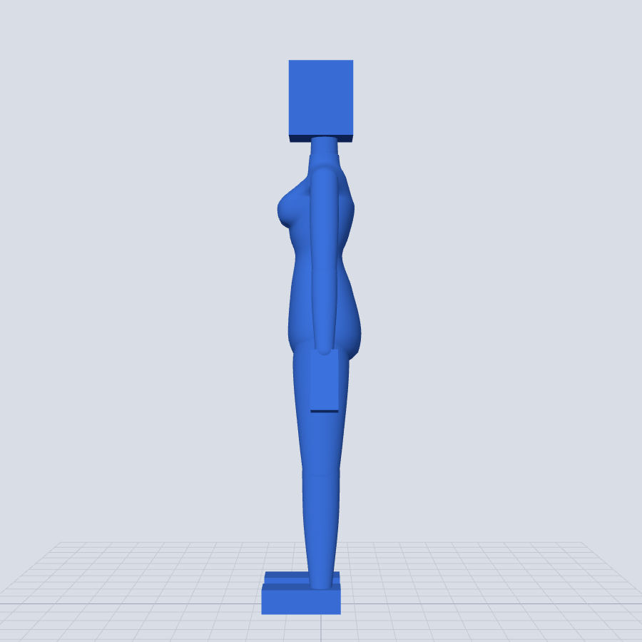
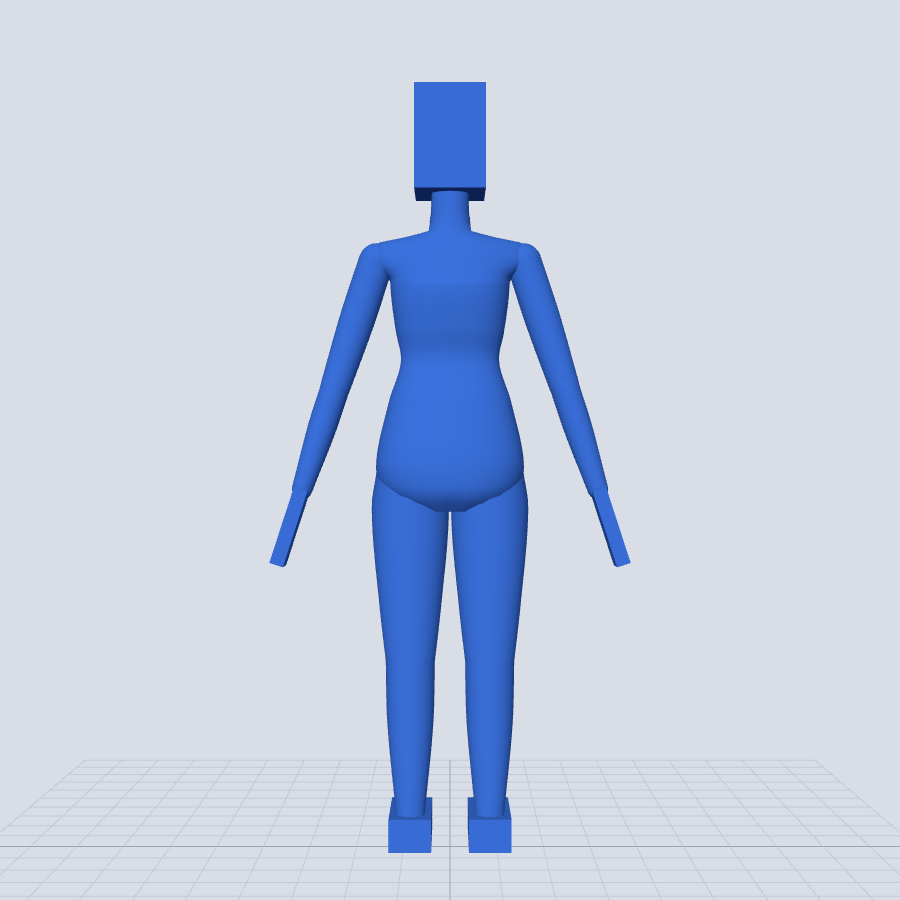

# 第1段階の報告：体を作る

日付：2026-11-26

## 作ったもの

- 全身の素体：胴（股〜首の付け根、胸つき）、首、腕（上腕・前腕）、脚（太もも・すね）、頭・手・足（仮の箱）。
- スライダー：大項目 6（全体・頭と首・胴・胸・腕・脚）→ 中項目 → 小項目、計 49 項目。体型プリセット（女性・男性）、性能プリセット（軽量・標準・高精細）。
- 骨格 17 本（スキンメッシュ）。「骨格を表示」で確認できる。
- GLB 書き出し（立ち姿＋関節の位置）、固定4視点の撮影（`npm run shots`）。

## テスト結果

`npm test`：34 件すべて合格（`reports/M1-test-list.txt`、数値は `reports/M1-test-metrics.json`）。

- すべての部位が閉じた形（穴なし・面の向きがそろう）：3 プリセット × 6 体型（女性・男性・ランダム4）。
- 寸法：足の裏が床（y = 0）、身長＝頭の箱の上端、骨の長さ（上腕・前腕・太もも・すね）・足首の高さ・股関節の間隔がスライダーの値どおり。
- 胴の周径（ウエスト・アンダーバスト・ヒップ）が指定どおり ±1% 以内。
- 左右対称（すべての頂点に鏡の相手がある）、スキンの重みの合計 = 1、腕の開きを増やすと手首が外へ動く。
- GLB を three.js で読み直して、メッシュと関節ノードがそろっている。

## 見た目の確認

| 正面 | 斜め左前 | 左側面 | 背面 |
|---|---|---|---|
|  |  |  |  |

骨格つき：`../screenshots/M1-skeleton/`、男性：`../screenshots/M1-male/`、画面全体：`../screenshots/M1/05_ui.png`。

正直な評価：

- 全身の比率はおおむね自然（初期値で身長 161.8cm）。胴・胸は photo-tex で調整した形のまま。
- 腕・脚は単純な筒なので、肘・ひざ・肩・股の付け根はマネキンのように部位の重なりで見える。
- 頭・手・足は箱（仮）。

## わかっている問題・まだやっていないこと

- 関節は部位の重なりなので、曲げると継ぎ目が見える（第2段階で動かしてから改善を検討）。
- GLB はまだ骨格（スキン）と動きなし。
- 作品一覧（サイト）には未登録、push もまだ。
