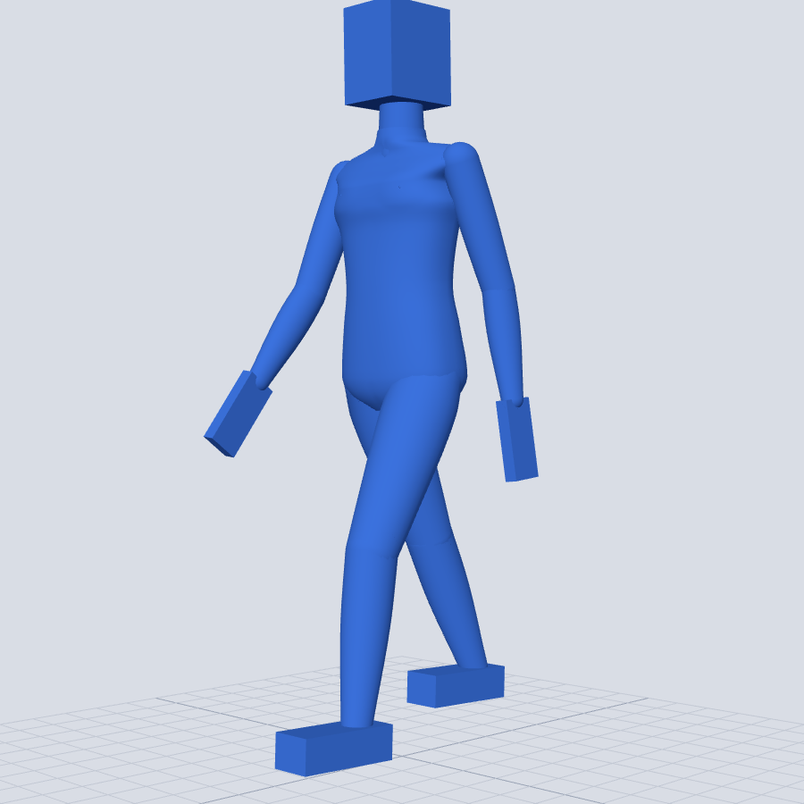
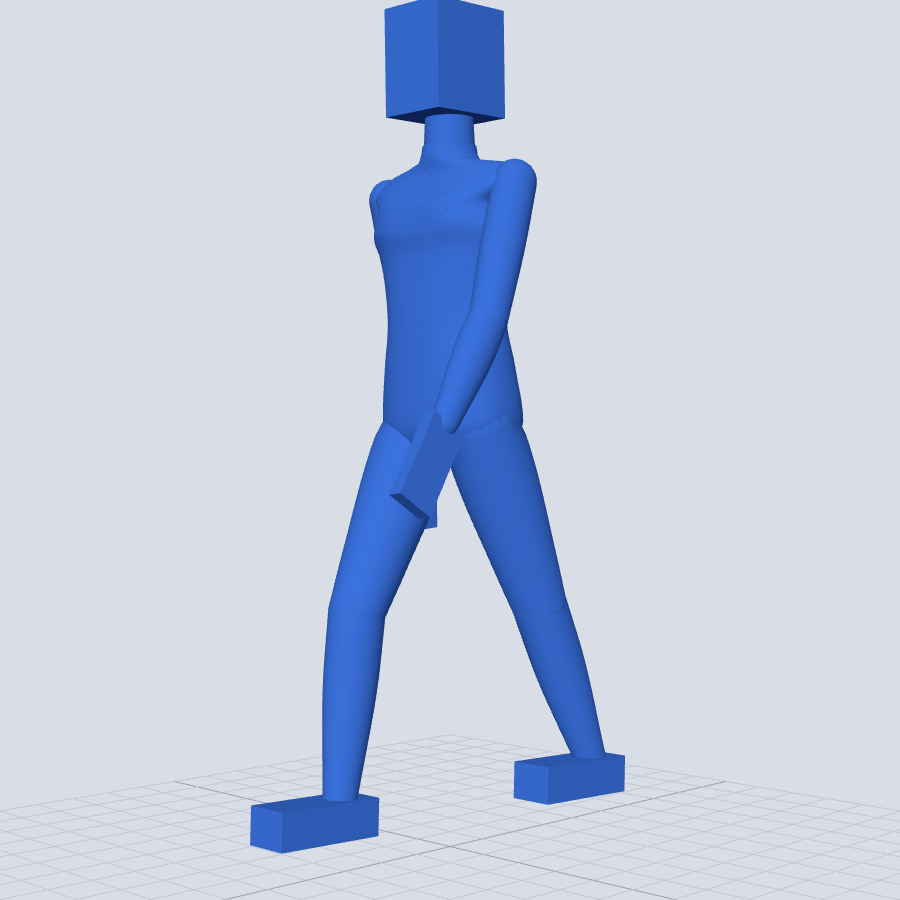
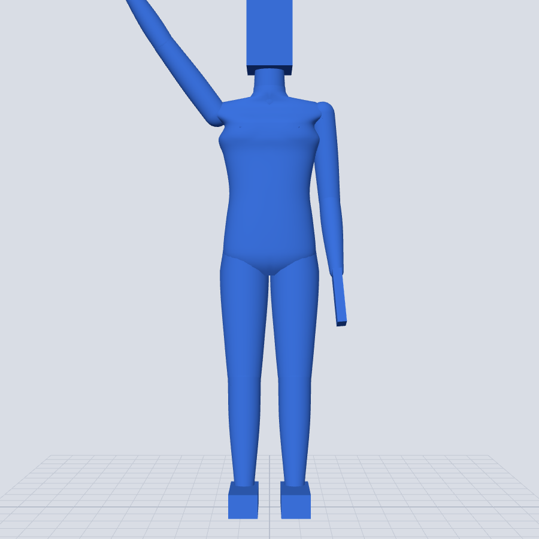

# 第2段階の報告：「モーション」の JSON で動かす

日付：2026-11-26

## 作ったもの

- 「モーション」で保存した JSON（`dizz-mocap-v1`）を開いて、体を動かす。再生・一時停止・1コマ送り／戻し・再生位置のスライダー・速さ（0.25〜2倍）・くり返し・立ち姿に戻す。
- 関節位置（33点）から 17 本の骨の回転を求める（腰・胸は肩と腰の線、頭は耳の線、腕・脚・足は骨の向き）。
- 手元に JSON がなくても試せる「サンプルの動き」（歩く→右手を振る、6秒）。
- アプリを開いたときの体型を男性に（実験用）。

## テスト結果

`npm test`：39 件すべて合格（`reports/M2-test-list.txt`）。

- 立ち姿と同じ関節位置を当てると、どの骨も回らない（最大 0.00001°）。
- サンプルの動き 180 コマすべてで、上腕・前腕・太もも・すねの向きが関節の向きと一致（最大誤差 0.000001°）、腰と肩の線の向きも一致（0°）。男性・女性とも。
- 1 コマの計算は 0.03〜0.07ms（Node、M4）。
- おかしな JSON（形式ちがい・関節数ちがい・fps 0）は読み込まない。
- 第1段階の体のテスト（閉じた形・寸法・周径・対称・GLB）もすべて合格。

## 見た目の確認

サンプルの動き（男性）：

| 歩く（0.25秒） | 歩く（0.75秒） | 手を振る（5.2秒） |
|---|---|---|
|  |  |  |

女性で歩く：`../screenshots/M2-female/motion_t0.75_threequarter.png`。固定4視点の立ち姿：`../screenshots/M2/`。

正直な評価：

- 腕・脚の振り、手を上げる動きは自然に見える。
- 関節は部位の重なりなので、肘・ひざ・肩・股の付け根を大きく曲げると継ぎ目が見える（マネキンのような見た目）。
- 歩くときに手（箱）が太ももに少し入り込む瞬間がある（当たり判定はない）。
- 途中で胸の前に横線（胴の形の折れ目）が見えたので直した（胸郭の断面の高さを胸の高さ位置から切り離した）。

## わかっている問題・まだやっていないこと

- 実際に「モーション」で撮った JSON ではまだ試していない（サンプルの動きのみ）。ぜひ一度試してください。
- 腕・脚のねじれ（前腕を回す動きなど）は関節位置からは決まらないので反映していない。
- 首・頭は耳の線で向きを決めている（うなずく動きはまだ）。
- 指（「指モーション」）、顔・手足のつくり込み、骨格と動きつきの GLB 書き出しは次の段階。

## 追記：体型プリセットの見直し（2026-11-26）

- 男性：わかりやすいゴツい体型に作り直し（広い肩、厚い胸郭、太い腕・脚・首、平らで広い胸筋、身長約 186cm）。
- 女性：作り込んだ胴・胸が手足と頭に比べて小さく見えていたので、胴・胸はそのままにして頭・首・腕・脚・手・足を胴に合う大きさに縮めた（身長約 153cm）。
- 見た目：`../screenshots/M3-male/`、`../screenshots/M3-female/`（立ち姿の4視点と、歩く・手を振るコマ）。テストは 39 件すべて合格。
