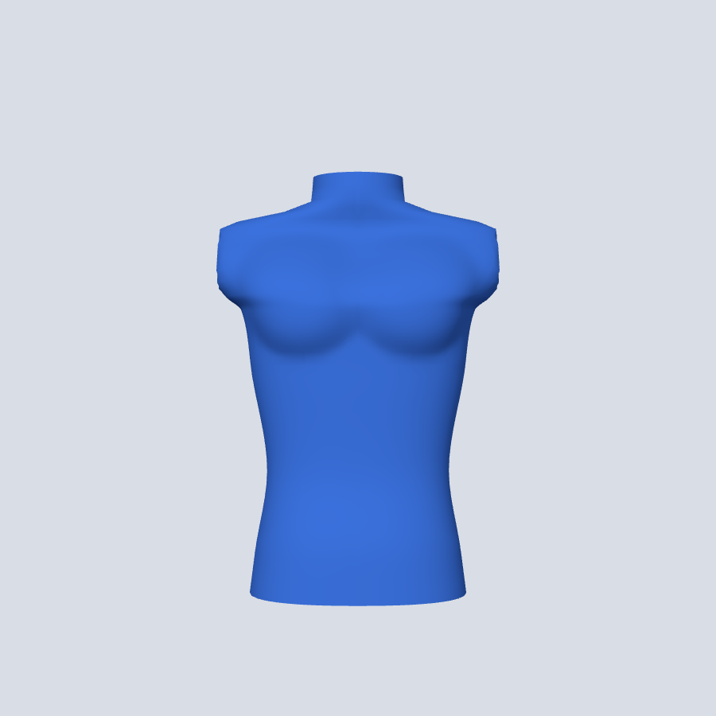
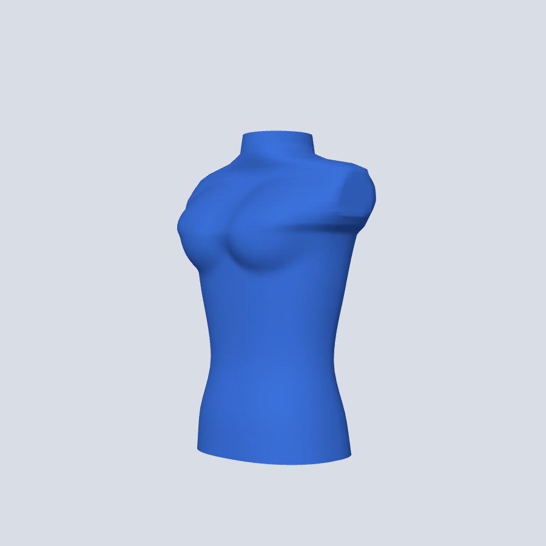
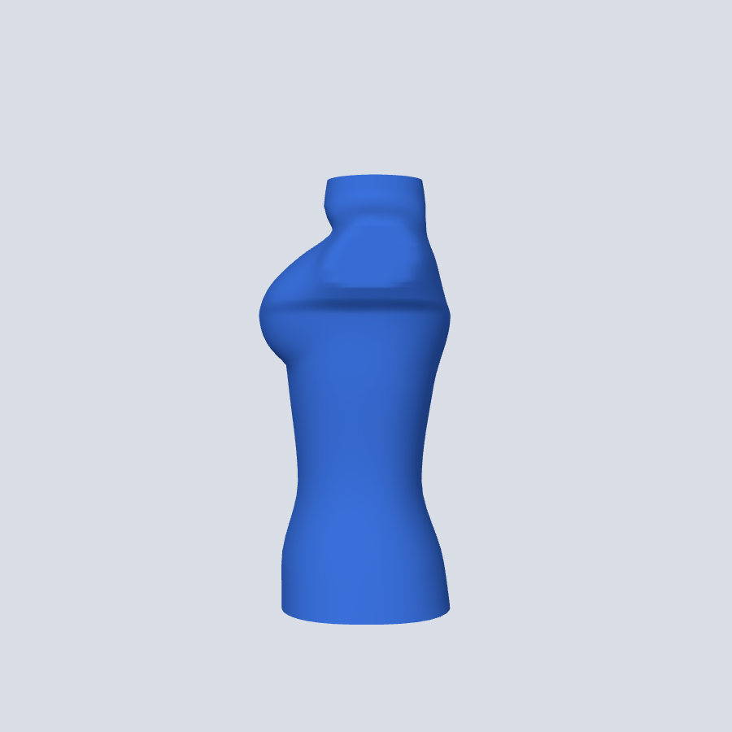
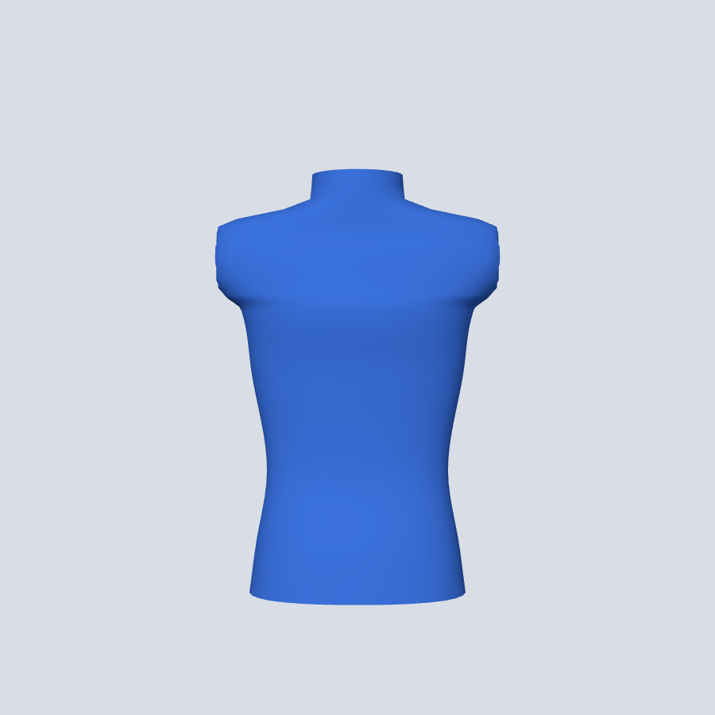
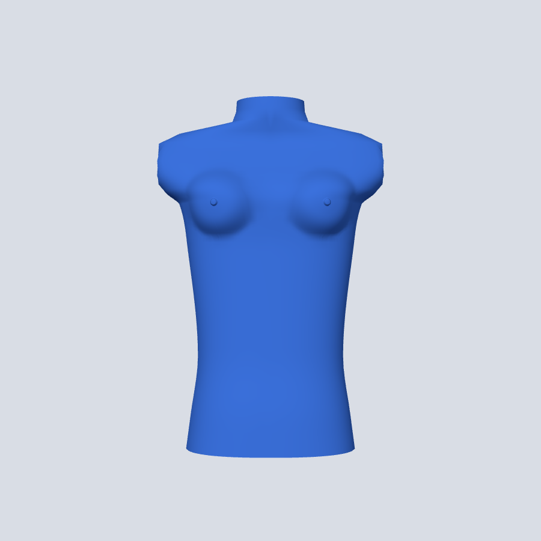
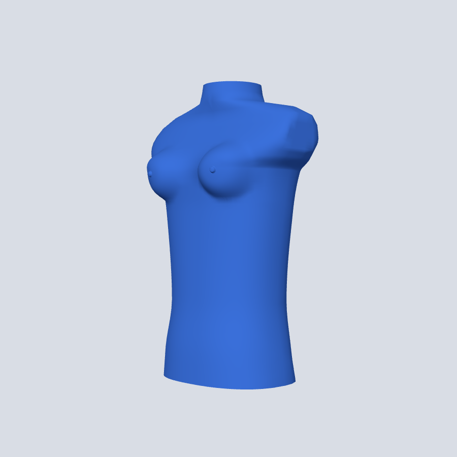

# M1 報告：素体とビューア

日付：2026-11-26　ブランチ：`photo-tex`（リポジトリ 20261111 の `photo-tex/`）

## 1. 作ったもの

- **固定視点の撮影スクリプト** `npm run shots`（Playwright＋Chromium）。プロジェクトファイルを読み込み、正面・斜め左前・左側面・背面の4枚を `photo-tex/screenshots/<マイルストーン>/` に保存する。カメラの距離（1.55m）・注視点・照明は固定。`--ui` を付けると画面全体と乳頭の拡大図も撮る。`--built` を付けると本番ビルドで撮る。ページのエラーや外部への通信があれば失敗として終わる。
- **素体（青）**：円筒状の格子（Light 48×40 / Standard 96×80 / High 160×128）、超楕円の断面を C1 でなめらかに補間、肩の平らな切断面、首と下端の平らなふた。水密（穴のない閉じた形）。
- **胸**：16個のパラメータすべて（大きさ・張り出し・付け根の幅と高さ・高さ位置・間隔・外向きの角度・下垂・上下の丸み・乳頭の位置と直径と高さ・乳輪の直径とふくらみ）。左右対称。
- **格子の密度**：胸と乳頭のまわりに頂点を集める単調な写像。Standard では乳頭の位置で約0.7mm 間隔。
- **画面（日本語）**：すべてのパラメータに、スライダー・数値入力（双方向に連動）・単位・初期値に戻すボタン。プリセットの切り替え、ワイヤーフレーム表示、視点ボタン（正面／斜め／左側面／背面）、マウスとタッチで回せるビュー。
- **GLB 書き出し（素体のみ）**：自作の GLB 書き出し処理。ノードは `base`（青）と、ランドマーク用の空ノード `LM_shoulderJoint_L/R`・`LM_neckBase`・`LM_navel`・`LM_nipple_L/R`・`LM_waist_L/R`。単位はメートル、+Y が上、+Z が前。
- **自動テスト** `npm test`（58件）、**GitHub Actions のワークフロー** `.github/workflows/build-photo-tex.yml`。

## 2. テスト結果

`npm test`：**58件すべて合格**（Apple M4、Node 24.22.3、約6秒）。数値の全体は `reports/M1-test-metrics.json`、テストの一覧は `reports/M1-test-list.txt`。

| テスト | 結果 | 数値 |
|---|---|---|
| 水密性（5.1-5）3プリセット×5体型（初期値＋ランダム4通り） | 15/15 合格 | 2面に共有されない辺 0、向きの不一致 0、つぶれた三角形 0、体積は正（Standard 初期値で 0.01895 m³） |
| 周径 ±1%（5.2）初期値＋ランダム7通り×3プリセット | 7/7 合格 | 断面の式で測った誤差：最大 3×10⁻⁷。メッシュを切って測った誤差：Light で最大 −0.67%、Standard で最大 −0.18%、High で最大 −0.065% |
| 張り出し → 胸の部分の最大Z | 合格 | 0 / 20 / 45 / 80 / 120mm → 93.99 / 107.90 / 133.14 / 168.57 / 209.16 mm |
| 付け根の幅 → 変形部分の X の広がり | 合格 | 70 / 100 / 120 / 150 / 180mm → 121.8 / 133.7 / 140.7 / 150.1 / 157.7 mm |
| 高さ位置 → 頂点の Y | 合格 | 30 / 33 / 37 / 40 / 44cm → 297.5 / 327.1 / 367.1 / 397.1 / 437.1 mm |
| 下垂 → 高さ位置から見た頂点の下がり | 合格 | 0 / 25 / 50 / 75 / 100 → 0 / 4.80 / 9.60 / 14.40 / 19.21 mm 下がる |
| 乳頭の直径 → 測った直径（高さの半分での全幅） | 合格 | 4 / 8 / 12 / 16 / 20mm → 3.40 / 6.83 / 10.25 / 13.68 / 17.10 mm |
| 自己交差なし（5.3-4）Standard、大きさ・張り出し・下垂・付け根の幅の 2⁴=16 の角＋極端な組み合わせ6通り | 22/22 合格 | 三角形どうしの交差 0、裏返った面 0（調べた組の数：最大 47,368） |
| 乳頭の格子密度（5.3-3）乳頭の直径 4mm | 合格（Standard） | Light：1.44×1.23mm 間隔、直径4mmの円内に8頂点 ／ Standard：0.72×0.60mm、28頂点 ／ High：0.43×0.37mm、76頂点 |
| 左右対称 | 合格 | 鏡像の頂点との差は最大 1.6×10⁻¹² m |
| GLB の往復（GLTFLoader）3プリセット | 3/3 合格 | ノード名がすべてあり、頂点数と索引数が一致。Light 114KB（2,058頂点）／Standard 441KB（7,954頂点）／High 1.16MB（20,930頂点） |
| プリセットの格子の大きさ（11.1） | 合格 | 48×40 / 96×80 / 160×128 |
| メッシュ生成時間（参考、合否なし） | — | Light 13.9ms／Standard 18.5ms／High 27.1ms（Node、M4） |

自動テスト以外の確認：

- **Blender 5.3** でバックグラウンド読み込み：3プリセットとも `FINISHED`（エラーなし）。オブジェクトは `base` とランドマーク8個。頂点数と面数は書き出しと一致（Standard：7,954頂点・15,360面）。
- 本番ビルドを `npm run shots -- --built` で表示：ページのエラー 0、外部への通信 0。
- 型チェック `tsc --noEmit`：エラー 0。

## 3. 見た目の確認

**注：下の画像は、7章の初期値変更（7-15 の最新の初期値）の後に撮り直したものです。** 以下の「正直な評価」の胸についての記述は、最初の初期値（張り出し 45mm）での評価です。

初期値・Standard・固定の4視点（900×900px）。

| 正面 | 斜め左前 | 左側面 | 背面 |
|---|---|---|---|
|  |  |  |  |

参考：画面全体（`05_ui.png`）、直径4mmの乳頭の拡大図（`06_nipple4mm_wire_closeup.png` ワイヤーフレームあり、`07_nipple4mm_closeup.png`）。

正直な評価（テストの合否とは別の話です）：

- **胸**：なめらかで、しわや折り返しはありません。乳頭・乳輪もはっきり見えます。斜めから見ると、ドームの形と外向きの角度は自然な範囲です。ただし、初期値（高さ位置 37cm／胴の高さ 50cm）では胸がかなり高く、脇のすぐ下にあるように見えます。これは仕様の仮の初期値どおりで、私は値を変えていません。調整をお願いします。
- **直径4mmの乳頭（Standard）**：ふつうの距離では丸く見えます。4.5cm まで近づくと、縁にわずかな角張りが見えます（直径方向に約6頂点）。
- **胴**：全体は「ネックつきのトルソー」として読めますが、のっぺりしています。肩の切断面は楕円に近い平らな面です。ただし側面から見ると、肩の部分が少し箱のように厚く見えます。正面では肩の上が平らで、なで肩ではありません。背中・脇腹は格子が粗い（約2〜3cm）ものの、シルエットはなめらかです（胸以外の細かさは優先度が低いという仕様のため、この程度にしています）。
- **陰影**：肩の切断面のふちは法線を平均しているので、角が少し丸く見えます。

## 4. わかっている問題・やっていないこと

1. **GitHub Pages の公開はまだです。** ワークフローは用意しましたが、ブランチ `photo-tex` を main に取り込んで push するまで動きません（main への push は公開になるので、了承をいただいてから行います）。公開先は `https://dizz4izabella4-droid.github.io/20261111/photo-tex/` になる予定です。ワークフロー自体も GitHub 上ではまだ一度も動かしていません。
2. 高さ位置をアンダーバストに近づけると、胸の下側が乳房下溝の線で押さえられて平たくなります（例：高さ位置 30cm・アンダーバスト 30cm では、頂点の変位がほぼ 0）。
3. 範囲内でもありえない組み合わせ（例：胴の高さ 40cm で胸の高さ 44cm）では、高さの順番を補正して警告を出します。周径はずらした後の高さで守ります。
4. 体型の断面の比率（幅・厚み・角の丸み）と、脇・肩の高さは仮の値で、統計データにもとづくものではありません。
5. 画面ではパラメータの保存・読み込みはまだできません（M5）。GLB に入るのは素体だけです（パーツは M2 以降）。
6. 診断パネル・IndexedDB・写真の読み込みは、それぞれの後のマイルストーンで作ります。
7. JS のバンドルは 582KB（gzip 148KB、three.js を含む）。ビルド時にサイズの警告が出ますが、動作に問題はありません。

## 5. ASSUMPTIONS.md に追加したこと

今回はすべて新しい記録です（`photo-tex/ASSUMPTIONS.md`）。主なもの：

- 置き場所は 20261111 の中、既存の Pages（ブランチ配信）で公開。SPEC.md は `photo-tex/` に置く。
- Node 24 を `~/.local/node` に入れた。`_src/` でビルドし、出力をコミットして、ワークフローが main で再ビルドする方式。
- UV は固定の一様格子で、実際の位置を密度写像で胸・乳頭に寄せる。ウエストとアンダーバストに輪を合わせる。
- 胸は「体の奥の点からの放射方向」に押し出す（折り返しを防ぐため）。外向きの角度と下垂は、頂点の位置をずらして表す。大きさは張り出しを固定したまま体積を変える。
- 胸はアンダーバスト（乳房下溝）より下を変形しない。
- 仕様にない基準の高さ（脇・肩関節・肩の上端・首の切断面）、ランドマークの位置の定義、GLB の UV の向き、照明はカメラに固定。

## 6. 手で確かめてほしいこと

1. 体型と胸の初期値（とくに胸の高さ位置 37cm）が意図どおりか。スライダーで調整して、気になる形を教えてください。
2. 公開後に iPhone 12（Safari）で Light プリセットが動き、回して快適か（体感で構いません。fps の測定は M5 の予定です）。
3. 書き出した GLB（画面の「GLB を書き出す」）を、手元の Blender やゲームエンジンで開けるか。
4. main への取り込みと公開の了承。

## 7. 追記：ユーザーの指示による初期値の変更（2026-11-26）

ご指摘：「胸の形が気持ち悪い。初期値は平らにして、調整で起伏をつけられるように。胸と胸が離れすぎ、飛び出しすぎ」。

- 初期値を変更：前方への張り出し 45→**0 mm**、乳頭の高さ 6→**0 mm**、乳輪のふくらみ 1→**0 mm**（初期状態は平ら）、左右の間隔 180→**150 mm**。範囲は変えていません。
- テストは、平らな初期値では胸の形を調べられないので、基準の形（張り出し 45mm・乳頭 6mm・乳輪 1mm）に間隔などの初期値を組み合わせて行うようにしました。58件すべて合格。
- 画像：`screenshots/M1/` は新しい初期値（平ら）で撮り直しました。起伏を足した例（張り出し 30mm・乳頭 4mm・乳輪 1mm、間隔 150mm）は `screenshots/M1-sample/`（プロジェクトファイル `_src/projects/sample-breast.json`）にあります。

| 初期値（平ら）正面 | 起伏の例 正面 | 起伏の例 斜め左前 |
|---|---|---|
|  |  |  |

### 7-2. 再変更（同日）

ご指示：「少し胸を出す。乳首は初期はなしで、調整で出せるように」。

- 前方への張り出しの初期値 0→**20 mm**。乳頭の高さ・乳輪のふくらみは **0** のまま（乳頭は「乳頭の高さ」スライダーで出せます）。
- テスト58件すべて合格。`screenshots/M1/` はこの初期値で撮り直しました（上の「初期値（平ら）」の欄の画像も、いまは張り出し 20mm のものです）。
- 見た目：正面・斜めからは控えめなふくらみに見え、しわや段差はありません。側面では、胸の上の肩まわりの厚み（箱っぽさ）は前と同じです。

### 7-3. 再々変更（同日）

ご指示：「なだらかに。まだ離れている。高さはいい。直径を増やそう」。

- 付け根の幅 120→**150 mm**、付け根の高さ 110→**140 mm**（直径を増やす）
- 左右の間隔 150→**130 mm**
- 上側の丸み 40→**15**、下側の丸み 60→**30**（ふちがなだらかな釣鐘形に近づく）
- 張り出し 20mm・乳頭なしはそのまま
- テスト58件すべて合格。`screenshots/M1/` を撮り直しました。
- 見た目：正面では、ふくらみが広く浅くなり、胸の間もつながって見えます。斜めからは、ふちの段差がなく、なだらかです。

### 7-4. ひとまわり大きく（同日）

ご指示：「もうひとまわり大きく」。

- 付け根の幅 150→**170 mm**、付け根の高さ 140→**160 mm**、張り出し 20→**24 mm**（全体を約1.15倍にして、形の比率を保つ）
- 間隔 130mm・丸み 15/30・乳頭なしはそのまま
- テスト58件すべて合格。`screenshots/M1/` を撮り直しました。
- 見た目：なだらかさを保ったまま、ふくらみが広くなりました。下の端がアンダーバストの線にわずかにかかりますが、段差は見えません。

### 7-5. 張り出しを抑え、ウエストを細く（同日）

ご指示：「高さを抑えて、ウエストを少し細く」。

- 前方への張り出し 24→**18 mm**（「高さ」は張り出しと解釈）
- ウエスト周径 64→**61 cm**
- 形の作り方の修正：以前は、下端とへその断面がウエスト周径に連動していたため、ウエストを細くすると下腹まで一緒に細くなり、くびれが出ませんでした。下端とへその断面を、アンダーバスト（胸郭）に連動させるように変えました。初期値の比率は以前と同じ形になるよう合わせています。
- テスト58件すべて合格（周径 ±1% を含む）。`screenshots/M1/` を撮り直しました。
- 見た目：正面から、ウエストのくびれが見えるようになりました。胸は浅く、なだらかです。

### 7-6. 上半身を短く（同日）

ご指示：「上半身の長さを少し減らして」。

- 胴の高さ 50→**47 cm**
- 脇と肩の位置は胴の高さに連動して下がるので、胸の位置関係を保つために、胸の高さ位置 37→**34.5 cm**、アンダーバストの高さ 30→**27 cm** も下げました。
- アンダーバストを 28.5 cm にした段階では、胸の下側が乳房下溝の線で押さえられて、横に筋が出ました。27 cm にすると筋は消えました。
- テスト58件すべて合格。`screenshots/M1/` を撮り直しました。

### 7-7. 胸を上げ、上向きに・下側を大きく（同日）

ご指示：「胸の高さを少し上げよう。少し上向きに、下側が大きくなるように」。

- 胸の高さ位置 34.5→**35.5 cm**
- 下側の丸み 30→**70**（下側がふっくら）、下垂 15→**0**（頂上を下げない）。上側の丸みは 15 のまま
- テスト58件すべて合格。`screenshots/M1/` を撮り直しました。
- 見た目：横から見ると、上側はなだらかに、下側は丸く張っていて、少し上を向いて見えます。
- 制約：「下垂」は 0 より小さくできないため、これ以上はっきり上に向けるには「上向き」の項目（頂上を上にずらす）を新しく作る必要があります。

### 7-8. 胴をさらに短く（同日）

ご指示：「胴の長さを少し縮めて、また調整」。

- 胴の高さ 47→**45 cm**
- 首の付け根からの胸の位置を保つため、胸の高さ位置 35.5→**33.5 cm**、アンダーバストの高さ 27→**25 cm**。ウエスト（14cm）・へそ（5cm）はそのまま。
- テスト58件すべて合格。`screenshots/M1/` を撮り直しました。
- 見た目：胴が短くなり、胸の形と、胸・脇・アンダーバストの位置関係は前と同じに保たれています。

### 7-9. 肩幅を狭く（同日）

ご指示：「肩幅を少し狭くして」。

- 肩幅（肩関節中心間）34→**32 cm**
- テスト58件すべて合格。`screenshots/M1/` を撮り直しました。
- 見た目：肩の切断面が内側に寄り、上半身が細く見えます。胸の外側は切断面に届かず、形は変わっていません。

### 7-10. 胸の後ろ側とウエストを細く（同日）

ご指示：「胸の後ろ側も少し外周を縮めてみて、合わせてウエストも」。

- ウエスト・アンダーバスト・胸・脇の断面で、背中側の厚みを **0.9倍** にしました（前側は変えない）。
- アンダーバスト周径 70→**67 cm**、ウエスト周径 61→**59 cm**。周径の値は、背中を削った後の断面で ±1% 以内に守っています。
- テスト58件すべて合格。`screenshots/M1/` を撮り直しました。
- 見た目：横から見ると、背中のウエストから胸にかけてが内側に入り、反りが出ました。正面ではウエストが少し細くなっています。
- 副作用：下端とへその幅はアンダーバストに連動させているため、下腹の横幅も約4%細くなりました。下腹を元の幅に戻したい場合は、下端の幅を固定する形に変えられます。

### 7-11. 胸を少し上げる（同日）

ご指示：「胸の高さを少し上げて、上向きは維持」。

- 胸の高さ位置 33.5→**34.5 cm**。上向きの形（下側の丸み 70・下垂 0・上側の丸み 15）はそのまま
- テスト58件すべて合格。`screenshots/M1/` を撮り直しました。
- 見た目：胸が1cm上がり、横から見た上向きの形（上側はなだらか、下側は丸く張る）は保たれています。

### 7-12. 胸をさらに上げ、背中の反りを強く（同日）

ご指示：「さらに高く、背中の反りを増して」。

- 胸の高さ位置 34.5→**35.5 cm**（上向きの形はそのまま）
- 背中側の厚み：ウエスト 0.9→**0.82倍**、アンダーバスト 0.9→**0.88倍**、胸と脇 0.9→**1.0倍**
- テスト58件すべて合格。`screenshots/M1/` を撮り直しました。
- 見た目：横から見ると、腰の後ろが深く入り、肩甲骨のあたりが張って、反りがはっきりしました。
- 副作用：周径（59cm）を守ったまま背中を薄くしたので、正面ではウエストの横幅が少し広がり、くびれが弱まりました。くびれを戻すには、ウエスト周径を下げます。

### 7-13. ウエストを57cmに（同日）

ご指示：「下げる（57cm）」。

- ウエスト周径 59→**57 cm**
- テスト58件すべて合格。`screenshots/M1/` を撮り直しました。
- 見た目：正面のくびれが戻りました。横から見た背中の反りは保たれ、腰の後ろがさらに少し深く入っています。

### 7-14. 胸をさらに上げる（同日）

ご指示：「胸の高さを上げて」。

- 胸の高さ位置 35.5→**36.5 cm**
- テスト58件すべて合格。`screenshots/M1/` を撮り直しました。
- 見た目：胸が上がり、上の端が肩のすぐ下まで来ています。斜めから見ると、胸の上側が胸板と一体になって見えます。
- 注意：脇の高さ（34cm）より上にあるため、これ以上上げると胸の上側が肩とつながり、形が崩れやすくなります。さらに上げたい場合は、脇・肩の位置（胴の高さに連動）も一緒に見直す必要があります。

### 7-15. 首に近づけず、前への張り出しを増やす（同日）

ご指示：「首に近づけるのではなく、前への突き出しを2段階増加、首から離していい」。

- 前方への張り出し 18→**26 mm**（1段階を 4mm と解釈して2段階）
- 胸の高さ位置 36.5→**34.5 cm**（首から離す）。上向きの形（下側の丸み 70・下垂 0）はそのまま
- テスト58件すべて合格。`screenshots/M1/` を撮り直しました。
- 見た目：横から見て、胸が前にはっきり張り出し、上側はなだらか、下側は丸く張った上向きの形です。胸の上の端は肩から離れました。
