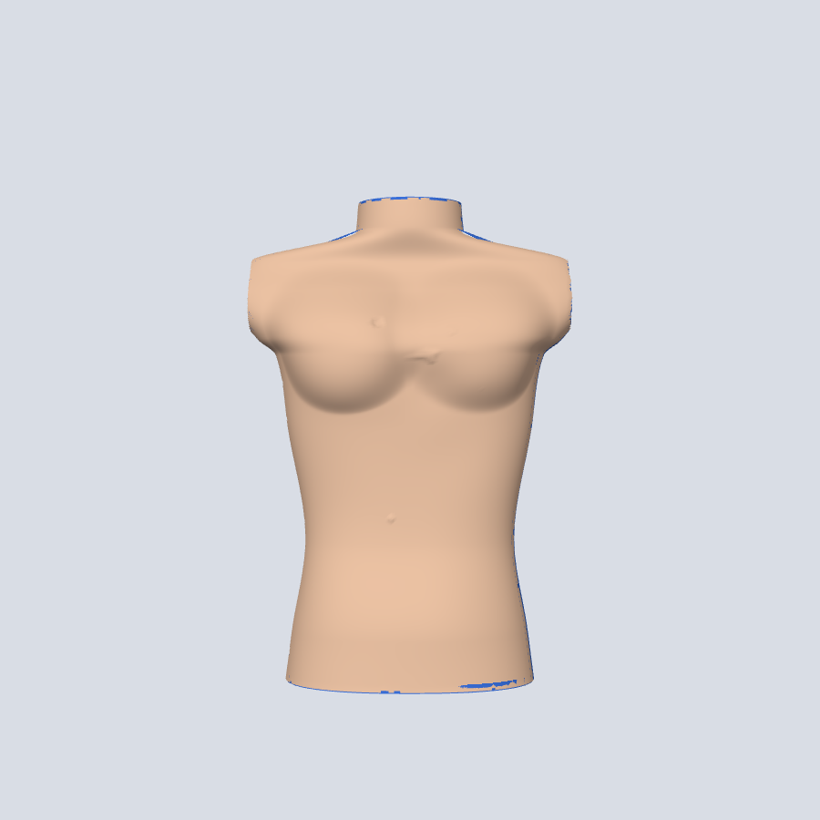
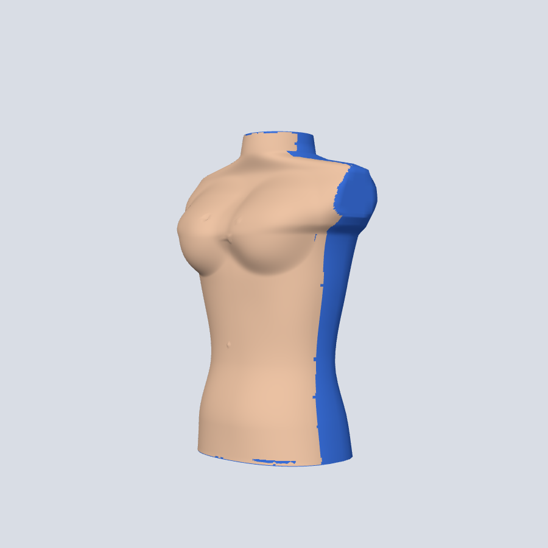
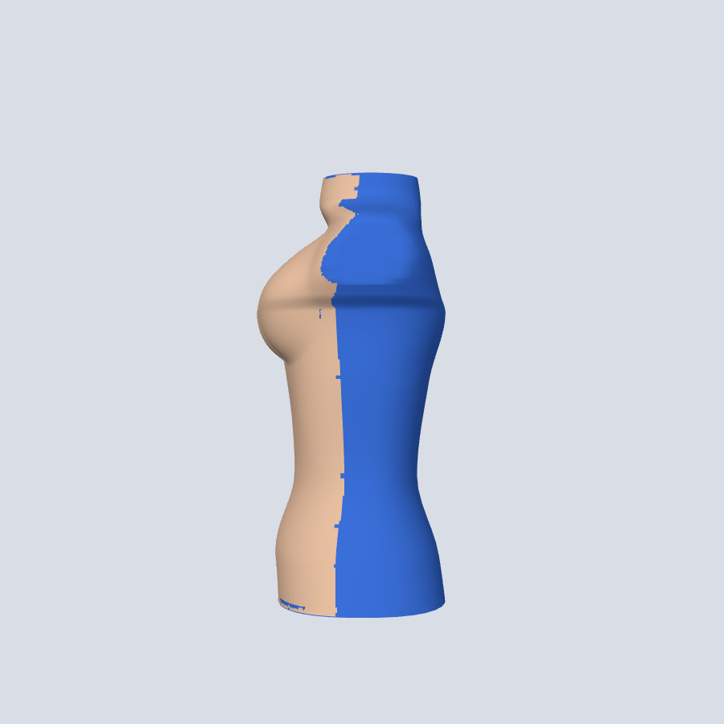
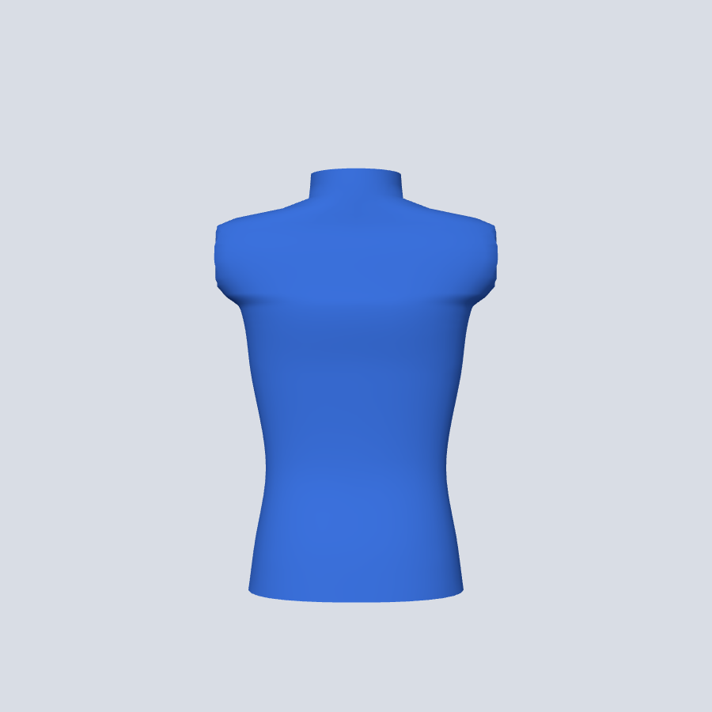
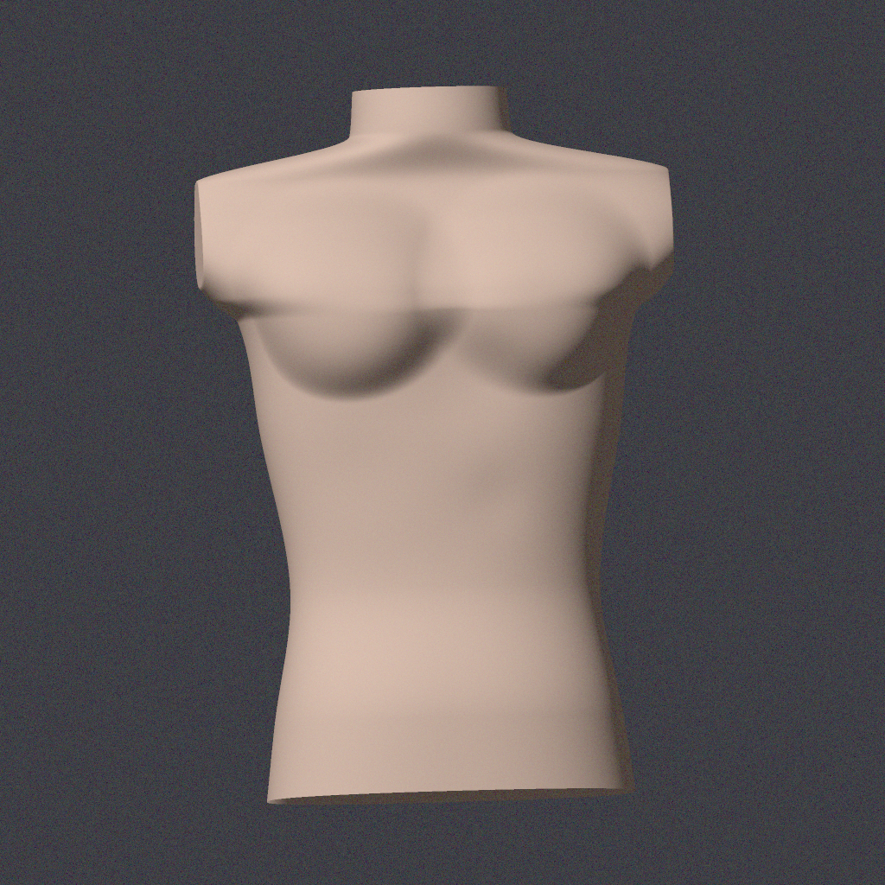
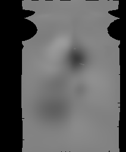
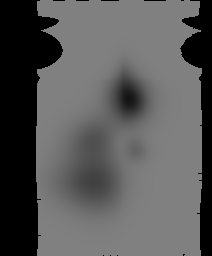
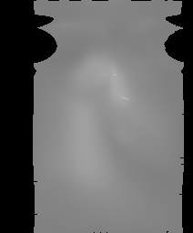

# M2 報告：合成データの検証環境と、写真1枚の分析

日付：2026-11-26　ブランチ：`photo-tex`（リポジトリ 20261111 の `photo-tex/`）

**結論：M2 の受け入れ条件「合成テストがすべて合格」は満たしていません。** 5 ケース中 C と E は合格、A・B・D は誤差（RMSE）のしきい値に届いていません（D は相関も不足）。しきい値は変えていません。数値は 2 章、原因と今後は 4 章にまとめました。

## 1. 作ったもの

- **合成データの検証環境**（`npm test`、仕様 13.1）：素体（初期値）＋ガウス形のふくらみ・へこみ 3〜6 個（±2〜10mm、σ15〜40mm、乱数の種は固定）を、ランバート反射・一様な色・1灯＋環境光・弱透視カメラで描画。ケース A（ノイズなし）、B（ノイズ σ=最大輝度の2%）、C（B＋暗い斑点5つ）、D（B＋目印を ±2px ずらす）、E（変位なし＋ノイズ）。分析には画像・目印・素体のパラメータ・設定だけを渡し、正解の光・カメラ・変位は渡しません。各ケースの入力画像・推定結果・正解・差・信頼度・数値を `test-output/<ケース>/` に保存（コピーを `reports/M2-synthetic/` に置きました）。
- **カメラの位置合わせ**（仕様 6.4）：弱透視カメラ（回転3・倍率・平行移動2）を、目印から頑健な最小二乗（Huber＋レーベンバーグ・マーカート法）で求める。目印ごとのずれ（px）を表示し、写真の長辺の3%を超えると警告。手動調整（左右・上下の回転、傾き、大きさ、位置）。
- **目印の画面**（仕様 6.3）：正面・背面・左右側面・斜めの目印一覧、タップ／クリックで置く、ドラッグで直す、ホイール／2本指で拡大・移動、タッチでドラッグ中は拡大鏡、元に戻す／やり直す、素体の線を写真に重ねて表示（濃さ調整）。目印を変えると「分析し直せます」と表示。
- **写真1枚の分析**（仕様 7）：Web Worker で実行、進み具合（手順名）と中止ボタンつき。前処理（切り出し・リニア化）→ 素体の深度バッファ → 除外マスク（白飛び・黒つぶれ・色ちがい・浅い角度）→ 光の推定（頑健）→ 形の推定（パーツの格子上、L-BFGS、粗い→細かいの多段階）→ ギザギザ補正（局所の実寸で）→ 信頼度 → パーツの範囲の整理。設定（解析解像度、ギザギザ補正、最大変位、素体への引き寄せ、光のモデル、色ちがいの k）は画面で変更可。
- **パーツの表示**（仕様 9）：肌色（#E8BFA0）の別メッシュ。素体の表面に沿って変位、+0.5mm 浮かせ、ふちを 3 テクセルでなだらかに素体へ。パーツ一覧で表示／非表示、破棄。
- **確認用スクリプト**：`npm run shots`（固定4視点に加え、パーツと目印の画面も撮影）、`node scripts/e2e-analysis.mjs`（本番ビルドのブラウザで「分析する」を押し、Worker 経由で分析が終わるまでを確認）。

## 2. テスト結果

`npm test`：**67 件中 64 件合格、3 件不合格**（Apple M4、Node 24.22.3、約7秒）。不合格は合成テストの A・B・D。一覧は `reports/M2-test-list.txt`。

### 合成データ（仕様 13.1、Standard 設定、信頼度 0.5 以上の範囲で評価）

| ケース | 相関 | 誤差（RMSE） | 正解の大きさ（RMS） | RMSE÷RMS | しきい値 | 判定 |
|---|---|---|---|---|---|---|
| A ノイズなし | **0.928** | 0.495 mm | 0.975 mm | **0.51** | 相関 ≥0.85 かつ ≤0.35 | **不合格**（誤差） |
| B ノイズ 2% | **0.881** | 1.102 mm | 1.614 mm | **0.68** | 相関 ≥0.85 かつ ≤0.35 | **不合格**（誤差） |
| C B＋暗い斑点 | **0.886** | 1.192 mm | 2.275 mm | 0.52 | 相関 ≥0.80 | **合格** |
| D B＋目印 ±2px | **0.749** | 1.384 mm | 1.859 mm | **0.74** | 相関 ≥0.85 かつ ≤0.35 | **不合格**（相関・誤差） |
| E 変位なし＋ノイズ | — | — | 0 | 推定の RMS **0.106 mm** | ≤1.0 mm | **合格** |

- 凹凸の逆転（相関がマイナス）はどのケースにもありません。
- 評価したテクセル数：各ケース約 3 万。
- カメラの位置合わせのずれ：A・B・C・E は 0.00px、D（目印 ±2px）は平均 1.63px。
- 分析時間（Standard、Node・M4）：1 ケース 0.59〜0.67 秒。ブラウザ（本番ビルド、ヘッドレス Chromium）で 0.7 秒。目標（PC で 10 秒以内）を十分下回ります。

### そのほか

- 素体のテスト（M1 の 61 件）：すべて合格。
- 形の推定のエネルギーの勾配：数値微分と一致（相対誤差 1.1×10⁻⁸）。
- ブラウザでの分析（Worker 経由）：ページのエラー 0、外部への通信 0（開発サーバー・本番ビルドとも）。
- 型チェック：エラー 0。

## 3. 見た目の確認

ケース C（暗い斑点あり）の分析結果を読み込んだ固定4視点（Standard）：

| 正面 | 斜め左前 | 左側面 | 背面 |
|---|---|---|---|
|  |  |  |  |

目印の画面（合成画像・目印・素体の線）：`../screenshots/M2/08_photo_landmarks.png`、画面全体：`../screenshots/M2/05_ui.png`

合成ケース B の推定結果（左から：入力、推定、正解、差。灰色が 0、白が外向き、黒がへこみ、±10mm）：

| 入力 | 推定 | 正解 | 差 |
|---|---|---|---|
|  |  |  |  |

正直な評価：

- **目印の画面**：素体の線が合成画像の胴にきれいに重なり、目印の名前も読めます。
- **パーツ**：正面から見える範囲をすき間なく覆い、へこみも素体に隠れず表示されます。正面から見て、ふくらみ・へこみの位置と形は正解とよく似ています。
- **不満な点**：
  - へこみが浅めに出ます（深さが正解の 6〜8 割程度）。
  - へこみのまわりがわずかに盛り上がります。
  - パーツのふちは、側面で階段状にギザギザしています。
  - 斑点のあった所に小さな点状の凹凸が少し残ります（ケース C）。

## 4. わかっている問題・やっていないこと

1. **合成テスト A・B・D が不合格**。原因を順に切り分けた結果（詳細は ASSUMPTIONS.md）：
   - 最初の大きな偽の起伏の原因は、①粗い段の作り方、②光が当たらない面の扱い、③素体の折れ目、④引き寄せ方、の4つでした。直した結果、変位なし（E）の偽の起伏は 0.8mm → 0.1mm、相関は A 0.42→0.93、B 0.70→0.88 まで改善しました。
   - 残る誤差は主に「へこみが浅く、まわりが少し盛り上がる」形です。1灯の陰影からは光の向きに沿った傾きしか直接決まらないため（写真1枚の陰影からの形推定の本質的な弱点）、どの解を選ぶかを平滑化と引き寄せに頼っています。
   - モデル自身が生成した明るさ（画像とのずれゼロ）でも誤差が 0.35〜0.4 程度残ることを確認したので、これ以上の改善には推定の作り方の変更が必要です。案は、(a) 光を形と交互に推定し直す（試作では B が 0.93 まで上がる一方、C が下がった）、(b) 平滑化を「光の向きに直交する方向」だけ強める異方性の平滑化、(c) 精密モード（M4、光を変えた複数枚）を使う、です。進め方をご相談させてください。
   - D（目印を ±2px ずらす）は、素体と写真の位置のわずかなずれがそのまま誤差になります。M3 の実写真の作業でも重要になる点です。
2. 精密モードのテスト（P）は M4 の範囲なので未実施。
3. GLB 書き出しにはまだパーツが入りません（素体のみ）。パーツの書き出しは今後のマイルストーンで行います。
4. 写真の取り込みは「1枚」のみ。撮影ガイド、除外・復元ブラシ、信頼度の色表示、再平滑化、深さ倍率、左右対称化は M3。
5. Worker は 1 つ（仕様の「最大4つ」は未対応、時間に余裕があるため）。
6. 実写真ではまだ試していません。

## 5. ASSUMPTIONS.md に追加したこと

M2 の項目として 14 件を追加しました。主なもの：

- パーツの格子を、素体メッシュの UV ではなく胴の表面座標（θ, y）にした。
- 弱透視カメラのみ。
- 遮蔽判定は細かい表面格子から作る。
- 色ちがいの除外を明るさで補正。
- 光が当たらない面と、素体の折れ目は、データから外す。
- 粗い段は細かい段の平均から作る。
- 引き寄せは外周で強く。外れ値の扱いは Huber。
- パーツの範囲の決め方と、パーツの内側では素体を描かない表示方法。
- Worker 1 つ。取り込む写真の長辺は 3000px まで。
- 合成データは影なし、斑点は色を変えずに暗く。
- プロジェクト JSON にパーツと写真を入れられるようにした。

## 6. 手で確かめてほしいこと

1. **実写真で一度試してください**（撮影ガイドどおり、1灯を斜め上から、無地の背景）。
   - 「写真と目印を表示」→ 目印を置く → 「分析する」の流れが分かりやすいか。
   - 結果のパーツが写真の起伏らしく見えるか。
2. スマホ（iPhone 12）で目印を置けるか。拡大・ドラッグ・拡大鏡の使い心地を確認してください。
3. 4 章 1 の改善案（a〜c）のどれを優先するか。合成テストのしきい値を満たすまで M2 に留まるか、M3 に進みながら改善を続けるか。
